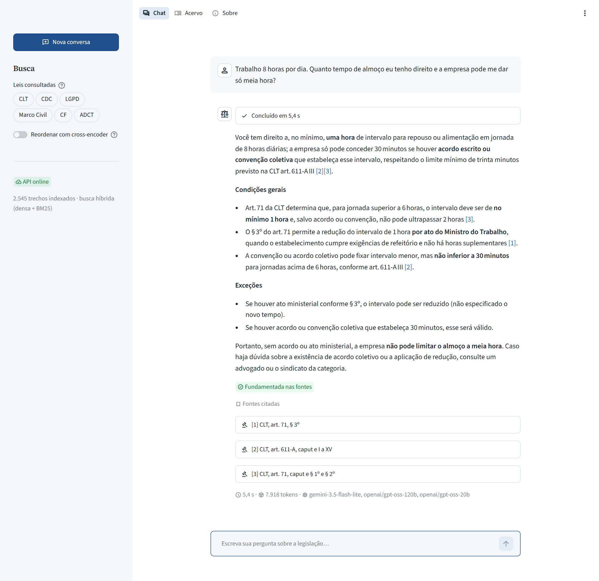
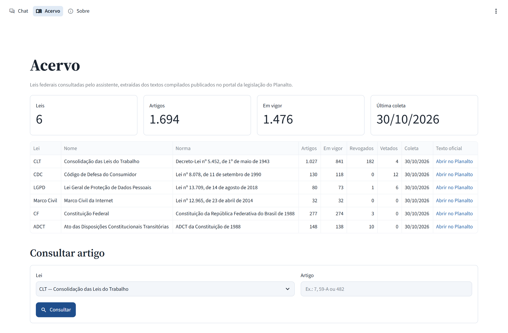
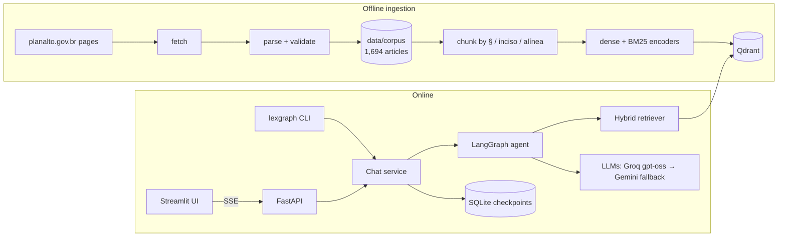
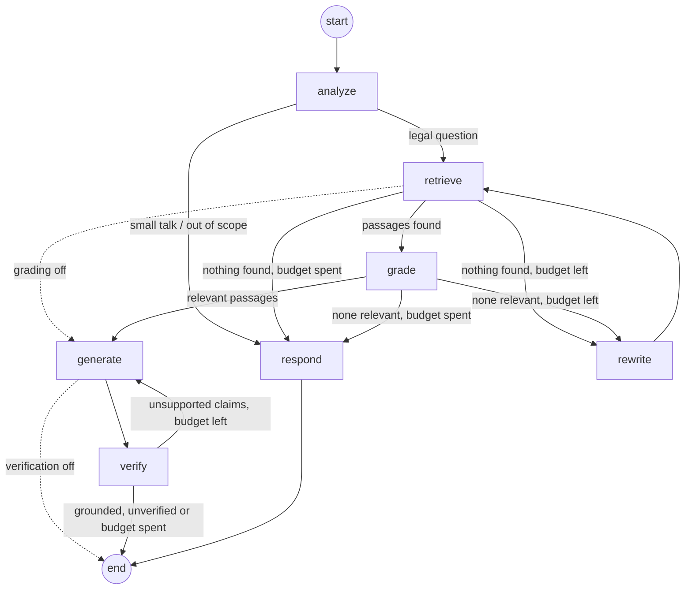

# LexGraph

[](https://github.com/gustavoleao1206-arch/lexgraph-rag-br/actions/workflows/ci.yml)


[](LICENSE)

**Agentic RAG over Brazilian federal legislation.** Ask about labor, consumer, data-protection,
internet or constitutional law in plain Portuguese and get an answer grounded in the official
text, with every legal statement cited down to the article, paragraph or inciso.

> 🇧🇷 [Leia em português](README.pt-BR.md)



<details>
<summary>Corpus page</summary>



</details>

Built with **LangGraph** (a corrective agent loop), **LangChain**, **Qdrant** (dense + BM25
hybrid search), **FastAPI** (Server-Sent Events) and **Streamlit**, with free-tier LLMs (Groq
`gpt-oss` with automatic fallback to Gemini).

## Highlights

- **Faithful ingestion of the official texts.** A purpose-built parser for the compiled pages
  of [planalto.gov.br](https://www.planalto.gov.br) removes revoked (struck-through) text and
  amendment notes, skips articles quoted inside amending laws, separates the ADCT from the
  Constitution and tolerates real typos in the source HTML. The six texts (CLT, CDC, LGPD,
  Marco Civil da Internet, the Federal Constitution and its ADCT; 1,694 articles) are validated
  on every build: no missing, duplicated or out-of-order article numbers.
- **Structure-aware chunking.** Long articles are split along their own units (§ → inciso →
  alínea), every slice keeps the caput as context, and citations name the exact units
  (`CF, art. 5º, LV a LVIII`). Notes on constitutional review by the Supreme Court
  (ADI/ADC/ADPF) travel with the passage, so the model can warn about them.
- **Hybrid retrieval, measured.** `embeddinggemma-300m` dense vectors plus Portuguese BM25 sparse
  vectors in Qdrant, fused with reciprocal rank fusion, optional cross-encoder reranking.
  Every configuration is benchmarked on a golden set (see [Evaluation](#evaluation)).
- **Corrective agent in LangGraph.** Query analysis → retrieval → relevance grading → query
  rewriting when nothing relevant was found → streamed answer with `[n]` citations →
  grounding self-check that regenerates unsupported answers.
- **Resilient multi-provider LLMs.** Strict JSON-schema structured outputs, per-role models,
  automatic fallback from Groq to Gemini, explicit timeouts, and graceful degradation when a
  provider is down or no API key is configured.
- **Production-minded service.** FastAPI with SSE streaming and a documented event protocol,
  conversation threads persisted by a SQLite checkpointer, optional API key, trusted-host and
  CORS protection, and a Streamlit UI that shows the agent's steps live.
- **Engineering hygiene.** mypy `--strict`, ruff, 1,200+ tests, GitHub Actions (lint, type
  check, tests on Python 3.12 and 3.13, Docker image build and a Compose smoke test), and a
  multi-stage Docker image that runs offline with the models baked in.

## Architecture



The agent graph:



| Node | What it does |
|---|---|
| `analyze` | Classifies the message, rewrites it as a standalone question and a statute-style search query (plus up to two sub-queries when the question touches more than one rule), and detects laws and article references (deterministic regex plus the model). |
| `retrieve` | Fetches explicitly cited articles first, then searches every query and interleaves the rankings; laws chosen by the agent act as a preference, a filter chosen by the user is strict. |
| `grade` | Keeps only the passages that help answer the question. |
| `rewrite` | Reformulates the search with the statute's vocabulary when nothing relevant came back. |
| `generate` | Streams the answer, citing every legal statement with `[n]`. |
| `verify` | Checks every claim against the sources and sends unsupported claims back as feedback. |
| `respond` | Fixed replies for small talk, out-of-scope questions and questions with no legal basis in the corpus (no model call). |

## Quickstart

Requirements: Python 3.12+, [uv](https://docs.astral.sh/uv/), about 2 GB of disk for the
models, and a free API key from [Groq](https://console.groq.com/keys) and/or
[Google AI Studio](https://aistudio.google.com/apikey).

```bash
git clone https://github.com/gustavoleao1206-arch/lexgraph-rag-br.git
cd lexgraph-rag-br
uv sync --all-extras
cp .env.example .env            # then paste GROQ_API_KEY and GOOGLE_API_KEY into .env
uv run python scripts/download_models.py
uv run lexgraph ingest          # embeds the committed corpus (about 20 min on a laptop CPU)
```

Ask from the terminal, or start the API and the web interface:

```bash
uv run lexgraph ask "Comprei um fone pela internet e me arrependi. Até quando posso desistir?"
uv run lexgraph serve           # http://127.0.0.1:8000 (OpenAPI docs at /docs)
uv run lexgraph ui              # http://localhost:8501
```

By default Qdrant runs embedded in the process (no server needed); only one process can open
it at a time, so stop the API before running `ingest`. Set `LEXGRAPH_QDRANT_URL` to use a
Qdrant server instead.

### Docker

```bash
cp .env.example .env            # add your keys
docker compose up --build       # Qdrant + one-shot ingest + API (:8000) + UI (:8501)
```

The first start indexes the whole corpus; `INGEST_ARGS="--law LGPD" docker compose up` indexes a
single law for a quick look. The image runs offline with the models baked in; build it with
`INCLUDE_RERANKER=true` to enable cross-encoder reranking.

## Evaluation

The golden set ([`data/eval/golden.jsonl`](data/eval/golden.jsonl)) has 55 questions written in
everyday Portuguese, each verified against the indexed statute text: direct lookups, conceptual
and multi-article questions, cross-law questions, questions about rules changed in 2026,
out-of-scope questions the system must decline, and adversarial ones (prompt injection and
false premises). Relevance is graded per article (expected vs. acceptable).

### Retrieval

Top 10 passages per question, scored per article (expected articles have grade 2, acceptable
ones grade 1), over the 49 in-scope questions; brackets hold 95% bootstrap confidence
intervals. The `+analyzer` rows search what the agent searches: the queries written by its
analyzer (a statute-style query plus sub-queries, rankings interleaved). The other rows search
the question as the user wrote it.

| Configuration | Hit@1 | Recall@10 | MRR@10 | nDCG@10 | p50 latency |
|---|---:|---:|---:|---:|---:|
| `dense` | 0.71 | 0.84 | 0.82 | 0.71 [0.63, 0.77] | 60 ms |
| `sparse` (BM25) | 0.27 | 0.56 | 0.38 | 0.38 [0.29, 0.47] | 65 ms |
| `hybrid` (RRF) | 0.57 | 0.85 | 0.72 | 0.64 [0.57, 0.71] | 146 ms |
| `hybrid+rerank` | 0.65 | 0.83 | 0.77 | 0.68 [0.61, 0.76] | 12 s |
| `dense+analyzer` | 0.69 | 0.86 | 0.82 | 0.75 [0.68, 0.81] | 47 ms |
| **`hybrid+analyzer`** (default) | 0.65 | **0.91** | 0.80 | **0.76** [0.70, 0.82] | 173 ms |

Latencies are measured on a laptop CPU and exclude the analyzer call, which the agent makes
anyway. What the numbers say:

- **On raw questions, dense beats hybrid** (nDCG@10 −0.065, 95% CI [−0.103, −0.029]):
  everyday wording shares few terms with the statutes, so BM25 adds weak matches that rank
  fusion mixes into the top positions.
- **Rewriting the question fixes that.** With the analyzer's queries, hybrid has the best
  nDCG@10 (+0.055 over raw dense, 95% CI [−0.016, +0.137]) and the highest recall@10, 0.91. It
  is the default.
- **Sub-queries trade precision at rank 1 for recall.** Their hits take every other slot, so
  Hit@1 drops, but more of what the answer needs reaches the top 10: on questions that need
  several articles, nDCG@10 goes from 0.55 to 0.77, and the share of specific incisos and
  paragraphs retrieved from 0.31 to 0.75 (8 questions). Recall is what matters here, because
  the grader filters the passages afterwards.
- **The cross-encoder does not pay off on a CPU**: about 12 s per question, below the
  analyzer's gain, so reranking is off by default.

The full report, with the breakdown by question type, paired differences and the recall of
specific incisos and paragraphs, is in [`reports/eval/summary.md`](reports/eval/summary.md).

### Answers

`lexgraph eval answers` asks the whole agent every golden question, paced to stay within the
free tiers, and records the answer, the route it took, its latency and time to first token.
Two layers score the answers:

- **Rule-based checks**, with no model: required facts and forbidden claims written as patterns
  for each question, citation precision and recall against the expected articles, citations
  that point outside the given sources, and refusal precision and recall on the out-of-scope
  questions.
- **LLM judge** (`lexgraph eval judge`): correctness against the reference answer, and
  groundedness, the share of claims supported by the cited passages. The judge is a different
  model from the ones that write the answers, to limit self-preference bias.

Reproduce with `uv run lexgraph eval retrieval`, `uv run lexgraph eval answers`,
`uv run lexgraph eval judge` and `uv run lexgraph eval report`; results land in
[`reports/eval`](reports/eval). Set `LEXGRAPH_JUDGE_MODEL` (or pass `--judge-model`) to choose
another judge.

## API

| Method | Path | Description |
|---|---|---|
| `GET` | `/health` | Liveness probe |
| `GET` | `/v1/info` | Models, retrieval settings and index size |
| `POST` | `/v1/chat` | Answer a question (`ChatResponse` with sources, citations, grounding, usage) |
| `POST` | `/v1/chat/stream` | Same, as Server-Sent Events: `status`, `sources`, `token`, `reset`, `final`/`error`, `done` |
| `GET` | `/v1/search` | Search the index without any language model |
| `GET` | `/v1/threads/{thread_id}` | Messages of a conversation |
| `GET` | `/v1/laws` | Laws in the corpus with article counts |
| `GET` | `/v1/articles/{article_id}` | Full text of one article, e.g. `CLT:482` |

```bash
curl -N -X POST http://127.0.0.1:8000/v1/chat/stream \
  -H "Content-Type: application/json" \
  -d '{"question": "Quantos dias de férias o trabalhador tem por ano?"}'
```

Request bodies are limited to 128 KiB (`413` above that). When `LEXGRAPH_API_KEY` is set, the
key is checked before the body is read.

## Configuration

Every setting is an environment variable with the `LEXGRAPH_` prefix (see
[`.env.example`](.env.example) for the full, commented list). The most useful ones:

| Variable | Default | Purpose |
|---|---|---|
| `LEXGRAPH_LLM_MODEL` | `groq:openai/gpt-oss-120b` | Model that writes the answers |
| `LEXGRAPH_FAST_LLM_MODEL` | `groq:openai/gpt-oss-20b` | Model for analysis, grading, rewriting and verification |
| `LEXGRAPH_LLM_FALLBACK_MODEL` | `google_genai:gemini-3.5-flash-lite` | Fallback when the primary provider fails |
| `LEXGRAPH_RETRIEVAL_MODE` | `hybrid` | `dense`, `sparse` or `hybrid` |
| `LEXGRAPH_TOP_K` | `10` | Passages retrieved per question and handed to the grader |
| `LEXGRAPH_RERANK` | `false` | Cross-encoder reranking (slow on CPU) |
| `LEXGRAPH_RERANK_CANDIDATES` | `20` | Passages the cross-encoder scores when reranking |
| `LEXGRAPH_QDRANT_URL` | unset | Qdrant server; embedded Qdrant when unset |
| `LEXGRAPH_API_KEY` | unset | Require an `X-API-Key` header on `/v1/*` |

Model specs take a provider prefix: `groq:`, `google_genai:` or `openai:` (the latter needs the
`openai` extra, which `uv sync --all-extras` already installs).

## Project layout

```
src/lexgraph/
├── ingestion/   fetch, parse and validate the official pages; chunk articles
├── retrieval/   embeddings, BM25, Qdrant store, hybrid retriever, reranker, indexer
├── agent/       LangGraph nodes and graph, prompts, model roles with fallbacks, citations
├── api/         FastAPI app, routes, SSE streaming, security
├── ui/          Streamlit pages (chat, corpus, about)
├── eval/        golden set, retrieval metrics, rules, LLM judge, runner, reports
├── service.py   chat service: runs the graph and turns its stream into events
└── cli.py       `lexgraph` command line
data/corpus/     parsed laws (JSON Lines) with a provenance manifest
data/eval/       golden evaluation set
```

## Development

```bash
uv run pytest                         # unit tests (no network, no keys, no models)
uv run pytest -m integration          # real embedding models (downloads them once)
uv run --env-file .env pytest -m llm  # one real question, end to end (needs a key and an index)
uv run ruff check . && uv run ruff format --check .
uv run mypy
```

## Limitations

- This is not legal advice. Answers cover only the six texts in the corpus, in the version
  fetched on the date recorded in [`data/corpus/manifest.json`](data/corpus/manifest.json), and
  do not replace the text published in the *Diário Oficial da União*.
- Court decisions are not in the corpus: the system can only warn that a provision was the
  subject of constitutional review when the official page notes it.
- Free tiers have tight limits (Groq: 8K tokens per minute per model). Prompts sent to the
  Gemini free tier may be used by Google to improve its products, so avoid personal data in
  questions.
- On a CPU, reranking adds several seconds per question and is off by default.

## Data and model credits

- Legal texts: [Portal da Legislação](https://www.planalto.gov.br/ccivil_03/) of the Brazilian
  Presidency. Legislative texts are not subject to copyright in Brazil (Lei nº 9.610/1998,
  art. 8º, IV). Laws are identified by their [LexML](https://www.lexml.gov.br) URNs.
- Dense embeddings: [EmbeddingGemma](https://ai.google.dev/gemma/docs/embeddinggemma), used
  under the [Gemma Terms of Use](https://ai.google.dev/gemma/terms).
- Sparse vectors: FastEmbed's `Qdrant/bm25` with Portuguese stemming; optional reranker:
  [`BAAI/bge-reranker-v2-m3`](https://huggingface.co/BAAI/bge-reranker-v2-m3) (Apache-2.0).

## License

[MIT](LICENSE) © 2026 Gustavo Leão
