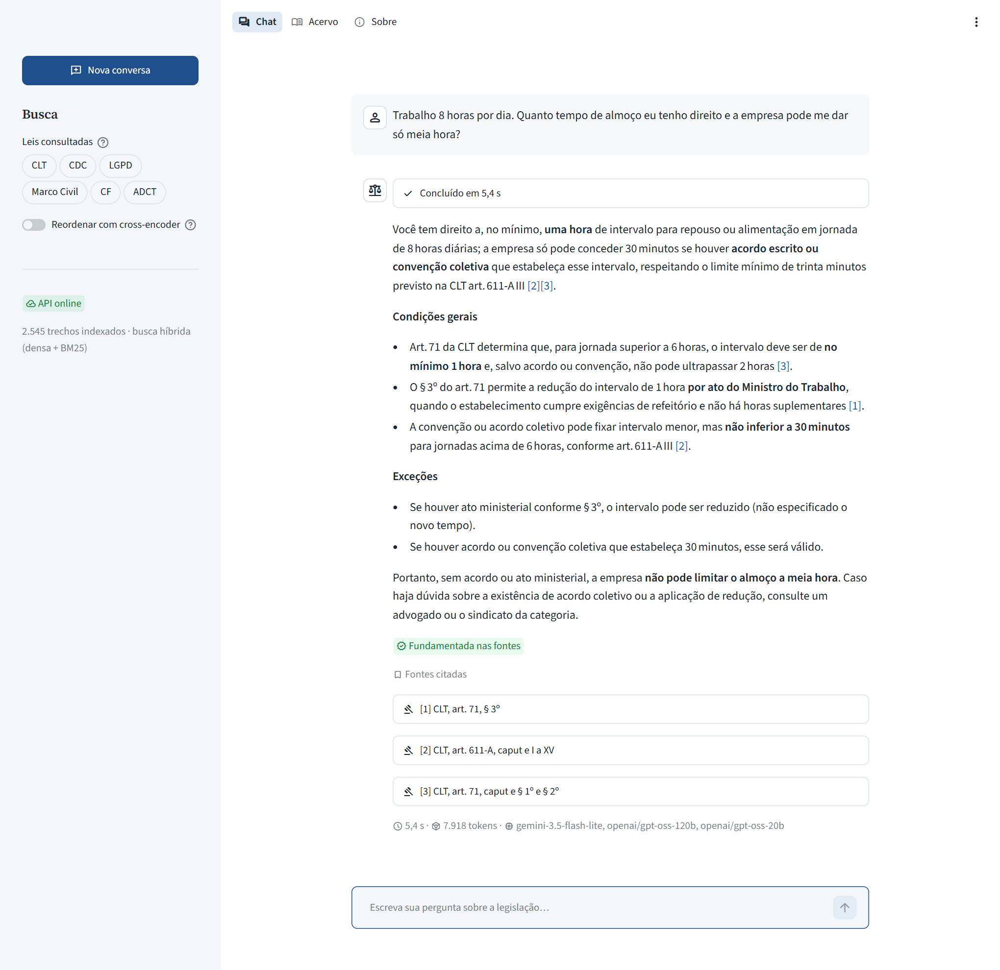
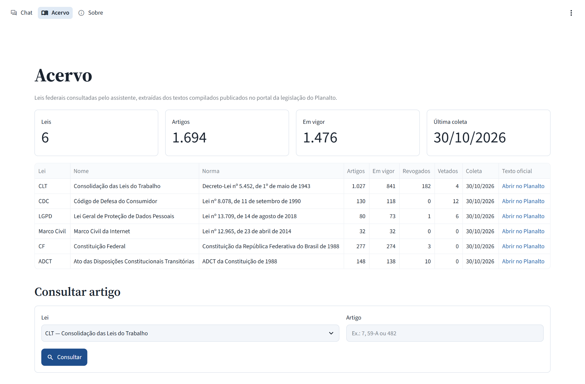
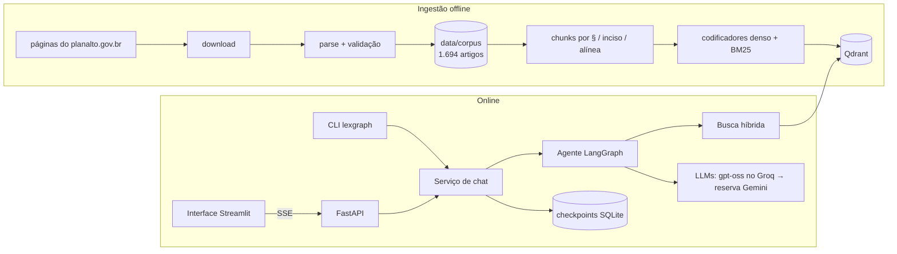
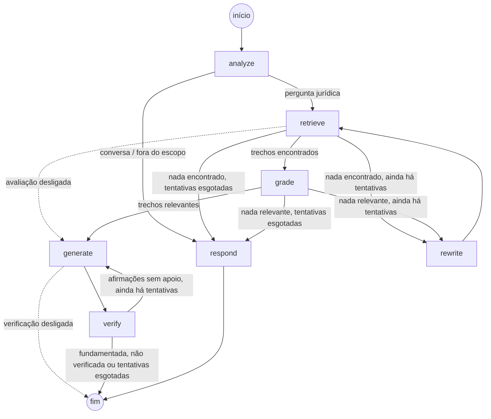

# LexGraph

[](https://github.com/gustavoleao1206-arch/lexgraph-rag-br/actions/workflows/ci.yml)


[](LICENSE)

**RAG agêntico sobre a legislação federal brasileira.** Pergunte sobre direito do trabalho, do
consumidor, proteção de dados, internet ou Constituição em linguagem comum e receba uma
resposta baseada no texto oficial, com cada afirmação jurídica citada até o artigo, parágrafo
ou inciso.

> 🇺🇸 [Read in English](README.md)



<details>
<summary>Página do acervo</summary>



</details>

Construído com **LangGraph** (um agente com laço corretivo), **LangChain**, **Qdrant** (busca
híbrida densa + BM25), **FastAPI** (Server-Sent Events) e **Streamlit**, usando LLMs com camada
gratuita (`gpt-oss` no Groq, com reserva automática no Gemini).

## Destaques

- **Ingestão fiel aos textos oficiais.** Um parser feito para as páginas compiladas do
  [planalto.gov.br](https://www.planalto.gov.br) remove o texto revogado (riscado) e as notas
  de alteração, ignora artigos citados dentro de leis alteradoras, separa o ADCT da
  Constituição e tolera erros reais de digitação do HTML. Os seis textos (CLT, CDC, LGPD,
  Marco Civil da Internet, Constituição Federal e o seu ADCT; 1.694 artigos) são validados a
  cada build: nenhum número de artigo faltando, duplicado ou fora de ordem.
- **Chunking que respeita a estrutura da lei.** Artigos longos são divididos pelas próprias
  unidades (§ → inciso → alínea), cada trecho mantém o caput como contexto e as citações
  nomeiam as unidades exatas (`CF, art. 5º, LV a LVIII`). Notas de controle de
  constitucionalidade no STF (ADI/ADC/ADPF) acompanham o trecho, e o modelo avisa sobre elas.
- **Busca híbrida, medida.** Vetores densos do `embeddinggemma-300m` e vetores esparsos BM25 em
  português no Qdrant, combinados por reciprocal rank fusion, com reranking opcional por
  cross-encoder. Cada configuração é medida num golden set (veja [Avaliação](#avaliação)).
- **Agente corretivo em LangGraph.** Análise da pergunta → busca → avaliação de relevância →
  reformulação da busca quando nada relevante aparece → resposta em streaming com citações
  `[n]` → autoverificação contra as fontes, que gera a resposta de novo quando há afirmações
  sem apoio.
- **LLMs resilientes, de vários provedores.** Saídas estruturadas com JSON schema estrito,
  modelo por função, reserva automática do Groq para o Gemini, timeouts explícitos e
  degradação controlada quando um provedor cai ou não há chave configurada.
- **Serviço pensado para produção.** FastAPI com streaming SSE e protocolo de eventos
  documentado, conversas persistidas por um checkpointer SQLite, chave de API opcional,
  proteção de hosts confiáveis e CORS, e uma interface Streamlit que mostra os passos do agente
  ao vivo.
- **Engenharia.** mypy `--strict`, ruff, mais de 1.200 testes, GitHub Actions (lint, tipagem,
  testes em Python 3.12 e 3.13, build da imagem Docker e smoke test do Compose) e imagem Docker
  multi-stage que roda offline com os modelos embutidos.

## Arquitetura



O grafo do agente:



| Nó | O que faz |
|---|---|
| `analyze` | Classifica a mensagem, reescreve como pergunta autônoma e como consulta no vocabulário da lei (mais até duas sub-consultas quando a pergunta envolve mais de uma regra), e detecta leis e artigos citados (regex determinística mais o modelo). |
| `retrieve` | Busca primeiro os artigos citados explicitamente, depois pesquisa cada consulta e intercala os rankings; leis escolhidas pelo agente são preferência, filtro escolhido pelo usuário é obrigatório. |
| `grade` | Mantém só os trechos que ajudam a responder. |
| `rewrite` | Reformula a busca com o vocabulário da lei quando nada relevante voltou. |
| `generate` | Gera a resposta em streaming, citando cada afirmação jurídica com `[n]`. |
| `verify` | Confere cada afirmação com as fontes e devolve as sem apoio como feedback. |
| `respond` | Respostas fixas para conversa, perguntas fora do escopo e perguntas sem base legal no acervo (sem chamar modelo). |

## Como rodar

Requisitos: Python 3.12+, [uv](https://docs.astral.sh/uv/), cerca de 2 GB de disco para os
modelos e uma chave gratuita do [Groq](https://console.groq.com/keys) e/ou do
[Google AI Studio](https://aistudio.google.com/apikey).

```bash
git clone https://github.com/gustavoleao1206-arch/lexgraph-rag-br.git
cd lexgraph-rag-br
uv sync --all-extras
cp .env.example .env            # depois cole GROQ_API_KEY e GOOGLE_API_KEY no .env
uv run python scripts/download_models.py
uv run lexgraph ingest          # indexa o corpus versionado (cerca de 20 min em CPU de notebook)
```

Pergunte pelo terminal, ou suba a API e a interface web:

```bash
uv run lexgraph ask "Comprei um fone pela internet e me arrependi. Até quando posso desistir?"
uv run lexgraph serve           # http://127.0.0.1:8000 (documentação OpenAPI em /docs)
uv run lexgraph ui              # http://localhost:8501
```

Por padrão o Qdrant roda embutido no processo, sem servidor. Só um processo pode abri-lo por
vez, então pare a API antes de rodar `ingest`. Defina `LEXGRAPH_QDRANT_URL` para usar um
servidor Qdrant.

### Docker

```bash
cp .env.example .env            # coloque suas chaves
docker compose up --build       # Qdrant + ingestão + API (:8000) + interface (:8501)
```

A primeira subida indexa o corpus inteiro; `INGEST_ARGS="--law LGPD" docker compose up` indexa
uma só lei para um teste rápido. A imagem roda offline com os modelos embutidos; construa com
`INCLUDE_RERANKER=true` para habilitar o reranking.

## Avaliação

O golden set ([`data/eval/golden.jsonl`](data/eval/golden.jsonl)) tem 55 perguntas em
linguagem do dia a dia, cada uma conferida contra o texto indexado da lei: consultas diretas,
perguntas conceituais e com vários artigos, perguntas que cruzam leis, perguntas sobre regras
alteradas em 2026, perguntas fora do escopo que o sistema deve recusar e perguntas adversariais
(prompt injection e premissas falsas). A relevância é graduada por artigo (esperado ou
aceitável).

### Recuperação

Os 10 primeiros trechos por pergunta, pontuados por artigo (artigos esperados têm grau 2,
aceitáveis grau 1), nas 49 perguntas dentro do escopo; entre colchetes, intervalos de
confiança de 95% por bootstrap. As linhas `+analyzer` buscam o que o agente busca: as consultas
escritas pelo seu analisador (uma consulta no vocabulário da lei mais sub-consultas, com os
rankings intercalados). As demais buscam a pergunta como o usuário a escreveu.

| Configuração | Hit@1 | Recall@10 | MRR@10 | nDCG@10 | Latência p50 |
|---|---:|---:|---:|---:|---:|
| `dense` | 0,71 | 0,84 | 0,82 | 0,71 [0,63; 0,77] | 60 ms |
| `sparse` (BM25) | 0,27 | 0,56 | 0,38 | 0,38 [0,29; 0,47] | 65 ms |
| `hybrid` (RRF) | 0,57 | 0,85 | 0,72 | 0,64 [0,57; 0,71] | 146 ms |
| `hybrid+rerank` | 0,65 | 0,83 | 0,77 | 0,68 [0,61; 0,76] | 12 s |
| `dense+analyzer` | 0,69 | 0,86 | 0,82 | 0,75 [0,68; 0,81] | 47 ms |
| **`hybrid+analyzer`** (padrão) | 0,65 | **0,91** | 0,80 | **0,76** [0,70; 0,82] | 173 ms |

As latências foram medidas na CPU de um notebook e não incluem a chamada do analisador, que o
agente faz de qualquer forma. O que os números mostram:

- **Com a pergunta crua, a busca densa vence a híbrida** (nDCG@10 −0,065, IC 95% [−0,103;
  −0,029]): a linguagem do dia a dia tem poucos termos em comum com a lei, então o BM25 traz
  correspondências fracas que a fusão de rankings mistura às primeiras posições.
- **Reescrever a pergunta resolve isso.** Com as consultas do analisador, a híbrida tem o melhor
  nDCG@10 (+0,055 sobre a densa crua, IC 95% [−0,016; +0,137]) e a maior cobertura em 10, 0,91.
  É o padrão.
- **As sub-consultas trocam precisão na 1ª posição por cobertura.** Os resultados delas ocupam
  posições alternadas, o que derruba o Hit@1, mas mais do que a resposta precisa chega ao top
  10: nas perguntas que exigem vários artigos, o nDCG@10 vai de 0,55 a 0,77, e a parcela de
  incisos e parágrafos específicos recuperados vai de 0,31 a 0,75 (8 perguntas). Cobertura é
  o que importa aqui, porque o avaliador de relevância filtra os trechos em seguida.
- **O cross-encoder não compensa em CPU**: cerca de 12 s por pergunta, abaixo do ganho do
  analisador, por isso o reranking fica desligado por padrão.

O relatório completo, com a divisão por tipo de pergunta, as diferenças pareadas e a
cobertura de incisos e parágrafos específicos, está em
[`reports/eval/summary.md`](reports/eval/summary.md).

### Respostas

`lexgraph eval answers` faz cada pergunta do golden set ao agente completo, em ritmo que cabe
nas camadas gratuitas, e registra a resposta, o caminho percorrido no grafo, a latência e o
tempo até o primeiro token. Duas camadas avaliam as respostas:

- **Verificações por regras**, sem modelo: fatos obrigatórios e afirmações proibidas escritos
  como padrões para cada pergunta, precisão e cobertura das citações em relação aos artigos
  esperados, citações que apontam para fora das fontes recebidas, e precisão e cobertura das
  recusas nas perguntas fora do escopo.
- **Juiz LLM** (`lexgraph eval judge`): correção em relação à resposta de referência e
  fundamentação, a parcela das afirmações apoiada pelos trechos citados. O juiz é um modelo
  diferente dos que escrevem as respostas, para reduzir o viés de autoavaliação.

Resultados nas 55 perguntas. O agente rodou com seus modelos padrão (`gpt-oss-120b` nas
respostas, Gemini como reserva) e o juiz foi o `qwen3.8-27b`, de uma família de modelos que o
agente nunca usa:

| Métrica | Resultado |
|---|---:|
| Perguntas fora do escopo recusadas (precisão / cobertura) | 1,00 / 1,00, nenhuma pergunta válida recusada |
| Artigo esperado chegou ao modelo da resposta | 1,00 (49 de 49) |
| Fatos obrigatórios presentes | 0,88 [0,78; 0,96] |
| Afirmações proibidas evitadas | 0,94 [0,82; 1,00] |
| Precisão / cobertura das citações | 0,96 / 0,93 |
| Fundamentação (juiz) | **0,95** [0,92; 0,98] |
| Correção (juiz: 1 correta, 0,5 parcial, 0 incorreta) | 0,67 [0,60; 0,74] |
| Latência p50 / p95, tempo até o primeiro token p50 | 7,0 s / 11,1 s, 4,8 s |

- **As respostas ficam dentro das fontes.** 95% das afirmações são sustentadas pelos trechos
  citados, e o agente recusou todas as perguntas fora do escopo sem recusar nenhuma válida.
- **A completude é o ponto fraco.** O juiz classificou 18 respostas como corretas, 30 como
  parciais e 1 como incorreta. Só 3 contradizem a resposta de referência; as demais parciais
  deixam de fora alguns dos seus pontos, como uma exceção secundária, provavelmente um custo
  das respostas curtas (cerca de 250 palavras) escritas a partir de cinco trechos.
- As latências não incluem as esperas impostas pelos limites das camadas gratuitas (cerca de
  um minuto por pergunta nesta execução). Quando o limite diário de tokens do Groq acabou,
  parte das chamadas do agente passou para o Gemini, como previsto.

Para reproduzir: `uv run lexgraph eval retrieval`, `uv run lexgraph eval answers`,
`uv run lexgraph eval judge` e `uv run lexgraph eval report`; os resultados ficam em
[`reports/eval`](reports/eval). Defina `LEXGRAPH_JUDGE_MODEL` (ou passe `--judge-model`) para
escolher outro juiz: os resultados acima usaram `--judge-model groq:qwen/qwen3.8-27b`, porque a
camada gratuita do juiz padrão, o Gemini 3.8 Flash, permite 20 requisições por dia, menos do que
o golden set exige. Os vereditos ficam em cache em `reports/eval/judge_cache.jsonl`, então
julgar as mesmas respostas de novo não gasta tokens.

## API

| Método | Caminho | Descrição |
|---|---|---|
| `GET` | `/health` | Verificação de vida |
| `GET` | `/v1/info` | Modelos, configuração da busca e tamanho do índice |
| `POST` | `/v1/chat` | Responde uma pergunta (`ChatResponse` com fontes, citações, verificação e uso de tokens) |
| `POST` | `/v1/chat/stream` | O mesmo, via Server-Sent Events: `status`, `sources`, `token`, `reset`, `final`/`error`, `done` |
| `GET` | `/v1/search` | Busca no índice sem modelo de linguagem |
| `GET` | `/v1/threads/{thread_id}` | Mensagens de uma conversa |
| `GET` | `/v1/laws` | Leis do acervo com contagem de artigos |
| `GET` | `/v1/articles/{article_id}` | Texto completo de um artigo, por exemplo `CLT:482` |

```bash
curl -N -X POST http://127.0.0.1:8000/v1/chat/stream \
  -H "Content-Type: application/json" \
  -d '{"question": "Quantos dias de férias o trabalhador tem por ano?"}'
```

O corpo das requisições é limitado a 128 KiB (`413` acima disso). Com `LEXGRAPH_API_KEY`
definida, a chave é conferida antes de o corpo ser lido.

## Configuração

Cada configuração é uma variável de ambiente com o prefixo `LEXGRAPH_` (a lista completa e
comentada está no [`.env.example`](.env.example)). As mais úteis:

| Variável | Padrão | Para quê |
|---|---|---|
| `LEXGRAPH_LLM_MODEL` | `groq:openai/gpt-oss-120b` | Modelo que escreve as respostas |
| `LEXGRAPH_FAST_LLM_MODEL` | `groq:openai/gpt-oss-20b` | Modelo de análise, avaliação, reformulação e verificação |
| `LEXGRAPH_LLM_FALLBACK_MODEL` | `google_genai:gemini-3.5-flash-lite` | Reserva quando o provedor principal falha |
| `LEXGRAPH_RETRIEVAL_MODE` | `hybrid` | `dense`, `sparse` ou `hybrid` |
| `LEXGRAPH_TOP_K` | `10` | Trechos recuperados por pergunta e entregues ao avaliador de relevância |
| `LEXGRAPH_RERANK` | `false` | Reranking por cross-encoder (lento em CPU) |
| `LEXGRAPH_RERANK_CANDIDATES` | `20` | Trechos pontuados pelo cross-encoder no reranking |
| `LEXGRAPH_QDRANT_URL` | vazio | Servidor Qdrant; sem ele, o Qdrant roda embutido |
| `LEXGRAPH_API_KEY` | vazio | Exige o cabeçalho `X-API-Key` em `/v1/*` |

Os modelos levam o prefixo do provedor: `groq:`, `google_genai:` ou `openai:` (este último
precisa do extra `openai`, que o `uv sync --all-extras` já instala).

## Estrutura do projeto

```
src/lexgraph/
├── ingestion/   download, parse e validação das páginas oficiais; chunking dos artigos
├── retrieval/   embeddings, BM25, armazenamento no Qdrant, busca híbrida, reranker, indexação
├── agent/       nós e grafo do LangGraph, prompts, modelos por função com reserva, citações
├── api/         app FastAPI, rotas, streaming SSE, segurança
├── ui/          páginas Streamlit (chat, acervo, sobre)
├── eval/        golden set, métricas de recuperação, regras, juiz LLM, execução, relatórios
├── service.py   serviço de chat: executa o grafo e transforma o stream em eventos
└── cli.py       linha de comando `lexgraph`
data/corpus/     leis processadas (JSON Lines) com manifesto de proveniência
data/eval/       golden set de avaliação
```

## Desenvolvimento

```bash
uv run pytest                         # testes unitários (sem rede, sem chaves, sem modelos)
uv run pytest -m integration          # modelos de embedding reais (baixa uma vez)
uv run --env-file .env pytest -m llm  # pergunta real de ponta a ponta (precisa de chave e índice)
uv run ruff check . && uv run ruff format --check .
uv run mypy
```

## Limitações

- Não é aconselhamento jurídico. As respostas cobrem só os seis textos do acervo, na versão
  obtida na data registrada em [`data/corpus/manifest.json`](data/corpus/manifest.json), e não
  substituem o texto publicado no Diário Oficial da União.
- Decisões judiciais não fazem parte do acervo: o sistema só consegue avisar que um
  dispositivo foi objeto de controle de constitucionalidade quando a página oficial registra
  isso.
- As camadas gratuitas têm limites apertados (Groq: 8 mil tokens por minuto por modelo).
  Perguntas enviadas à camada gratuita do Gemini podem ser usadas pelo Google para melhorar
  seus produtos, então evite dados pessoais nas perguntas.
- Em CPU, o reranking acrescenta vários segundos por pergunta e vem desligado por padrão.

## Créditos de dados e modelos

- Textos legais: [Portal da Legislação](https://www.planalto.gov.br/ccivil_03/) da Presidência
  da República. Textos legislativos não são protegidos por direito autoral no Brasil (Lei nº
  9.610/1998, art. 8º, IV). As leis são identificadas por suas URNs do
  [LexML](https://www.lexml.gov.br).
- Embeddings densos: [EmbeddingGemma](https://ai.google.dev/gemma/docs/embeddinggemma), usado
  conforme os [Termos de Uso do Gemma](https://ai.google.dev/gemma/terms).
- Vetores esparsos: `Qdrant/bm25` do FastEmbed com stemming em português; reranker opcional:
  [`BAAI/bge-reranker-v2-m3`](https://huggingface.co/BAAI/bge-reranker-v2-m3) (Apache-2.0).

## Licença

[MIT](LICENSE) © 2026 Gustavo Leão
